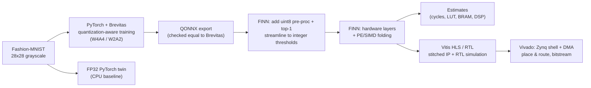
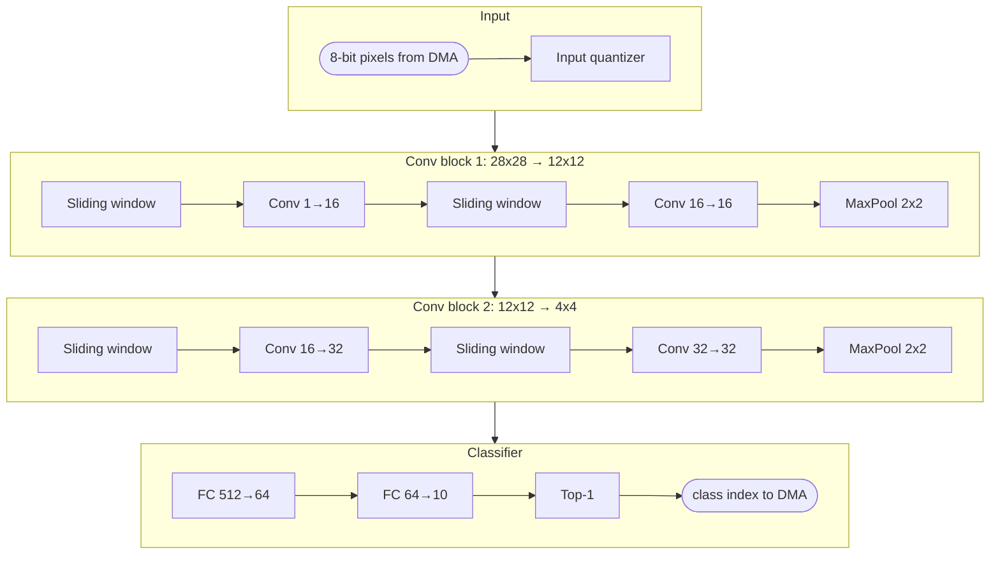

# FPGA-Accelerated Quantized Image Classifier Using FINN

> **Work in progress.** A small quantized CNN that classifies Fashion-MNIST clothing images, compiled into a streaming FPGA accelerator with [FINN](https://github.com/Xilinx/finn), AMD Research's open-source compiler for quantized neural networks. Target: the AMD AUP-ZU3 board (Zynq UltraScale+ `xczu3eg`). The project compares an FP32 CPU baseline with 4-bit and 2-bit quantized versions, and reports FINN estimates, RTL simulation and Vivado implementation results, each labelled by where it came from.

## Status

| Stage | Status |
|---|---|
| FINN environment on Windows (WSL2 + Docker) | Done: FINN's software test suite passes |
| FINN tutorials (ONNX basics, Brevitas → QONNX → FINN import) | Done |
| Vivado/Vitis 2024.2 connected to FINN (Vitis HLS + RTL simulation verified) | Done |
| FINN end-to-end tutorial built to a bitstream for the AUP-ZU3 (no board) | Done: timing met at 100 MHz |
| Own project: Fashion-MNIST quantized CNN, CPU baseline, FINN estimates | In progress |
| Own project: RTL simulation and Vivado build | Planned |
| On-board measurements | Needs an FPGA board (AUP-ZU3 or Kria KV260) |
| Upstream contribution to FINN | In progress |

## Architecture

**From trained model to hardware**



**The accelerator: one hardware block per layer, all running at once (dataflow pipeline)**



| Layer | Output | Multiply-accumulates per image |
|---|---|---:|
| Conv 3×3, 1→16 | 16×26×26 | 97,344 |
| Conv 3×3, 16→16 + MaxPool | 16×12×12 | 1,327,104 |
| Conv 3×3, 16→32 | 32×10×10 | 460,800 |
| Conv 3×3, 32→32 + MaxPool | 32×4×4 | 589,824 |
| FC 512→64 | 64 | 32,768 |
| FC 64→10 | 10 | 640 |
| **Total** | | **2,508,480** (about 50k parameters) |

The topology follows FINN's reference CNV network, scaled down for 28×28 input: no-padding 3×3 convolutions, BatchNorm, signed activations, and pooling only on even feature-map sizes. That lets FINN map every layer, including the 8-bit input stage and the top-1 output, to hardware.

## Results

See [`RESULTS.md`](RESULTS.md) for the baseline vs. FINN comparison. Earlier verified results (FINN tutorial network):

| What | Result | Type |
|---|---|---|
| FINN `v1.0.0-alpha` non-Vivado test suite | 2736 passed, 16 skipped, 5 xfailed, 1 xpassed | Software tests |
| FINN `test_fpgadataflow_checksum` (AUP-ZU3 part) | Passed: Vitis HLS synthesis + C++ and RTL simulation | HLS + RTL simulation |
| FINN `tfc_end2end_example` → bitstream for AUP-ZU3 | Timing met at 100 MHz (WNS +3.81 ns). Accelerator: 8,246 LUTs (11.7%), 11 BRAM36, 0 DSPs | Vivado post-route ([details](docs/results-tfc-end2end.md)) |

**Results policy:** every number is labelled as *measured (software)*, *estimate* (FINN analytical model), *simulation* (RTL sim), *synthesis report* (Vivado), or *measured (hardware)*. No FPGA resource, timing, throughput or power figures are claimed without the corresponding run.

## How to reproduce

Requires the FINN Docker setup from [`docs/windows-wsl-setup.md`](docs/windows-wsl-setup.md) (Linux or WSL2, Docker, FINN `v1.0.0-alpha`). Vivado/Vitis 2024.2 is only needed for the full hardware build.

```bash
# on the host: start a FINN shell with this repo mounted
cd ~/finn
FINN_DOCKER_EXTRA="-v $HOME/finn-fpga-image-classifier:$HOME/finn-fpga-image-classifier" ./run-docker.sh

# inside the FINN container
cd /home/<user>/finn-fpga-image-classifier
bash scripts/run_all.sh                                   # tests, training, CPU baseline, FINN estimates (no Vivado)
python finn_build/build.py --model w4a4 --mode full       # HLS, RTL simulation, Vivado bitstream (needs Vivado)
python scripts/collect_results.py                         # refresh results/summary.md
```

| Script | What it does | Output (in `runs/<model>/`) |
|---|---|---|
| `scripts/train.py` | Train FP32 / W4A4 / W2A2 on Fashion-MNIST (MD5-checked download) | `model.pt`, `metrics.json` |
| `scripts/cpu_baseline.py` | FP32 PyTorch latency and throughput on the CPU | `cpu_baseline.json` |
| `scripts/export_qonnx.py` | Export to QONNX; check outputs equal Brevitas; save golden I/O | `model_qonnx.onnx`, `export_check.json` |
| `finn_build/build.py` | FINN build: `--mode estimate` (no Vivado) or `--mode full` | `finn_estimate/`, `finn_full/` |
| `scripts/finn_accuracy.py` | Accuracy of the FINN-transformed integer graph on the test set | `finn_accuracy.json` |
| `finn_build/sweep.py` | Estimated throughput vs. LUT/BRAM for several FINN folding targets | `folding_sweep.json` |
| `scripts/collect_results.py` | All of the above → Markdown tables | `results/summary.md` |

Tests (`python -m pytest tests`) check dataset checksums, model shapes, that weights really use ≤ 2^b − 1 levels, operation counts (cross-checked against FINN's report), exact QONNX export, and that FINN maps every layer to hardware with its verification steps passing.

## Troubleshooting

| Symptom | Fix |
|---|---|
| `ModuleNotFoundError: brevitas` / `finn` | Run inside the FINN container (`./run-docker.sh`), not in plain WSL |
| `cd: /home/<user>/finn-fpga-image-classifier: No such file` inside the container | Start the container with the `FINN_DOCKER_EXTRA="-v ..."` line above so the repo is mounted |
| `MD5 mismatch` for a dataset file | Delete it from `data/fashion/` and rerun; it is downloaded again |
| `model_qonnx.onnx not found` | Run `scripts/export_qonnx.py --model <model>` before the FINN build |
| Estimate build fails with `TypeError: 'NoneType' object is not subscriptable` in `build_dataflow_checks.py` | FINN bug when Vivado isn't detected and `board=` is set; this repo's estimate mode passes `fpga_part` instead, so it doesn't hit it |
| Full build: Vivado not found | `export FINN_XILINX_PATH=/tools/Xilinx FINN_XILINX_VERSION=2024.2` before `./run-docker.sh` |
| Notebook `showInNetron`: `Address already in use` | Shut down other running notebook kernels |

## Repository layout

```
src/fmnist_finn/   data loading (MD5-verified) and models (Brevitas quantized CNN + FP32 twin)
scripts/           train, export, CPU baseline, FINN accuracy check, results collection, run_all.sh
finn_build/        FINN build configuration (AUP-ZU3, 100 MHz) and folding sweep
tests/             pytest tests
results/           small result files and generated summary (runs/ is git-ignored)
docs/              FINN notes, setup guide and log, tutorial build results
```

## Documentation

- [`RESULTS.md`](RESULTS.md): baseline vs. FINN comparison for this project.
- [`docs/PROJECT_NOTES.md`](docs/PROJECT_NOTES.md): how FINN works, the dataflow architecture, PE/SIMD folding, and how throughput, latency, LUTs, BRAM, DSPs, clock and power relate.
- [`docs/results-tfc-end2end.md`](docs/results-tfc-end2end.md): post-route results for FINN's end-to-end tutorial on the AUP-ZU3.
- [`docs/setup-log.md`](docs/setup-log.md): every setup command, version, error and fix.
- [`docs/windows-wsl-setup.md`](docs/windows-wsl-setup.md): setup guide for running FINN on Windows via WSL2.

## Tools

FINN `v1.0.0-alpha` · Brevitas · QONNX/ONNX · PyTorch · Docker · WSL2 (Ubuntu) · Vivado / Vitis HLS 2024.2 · pytest

## Acknowledgements

Built on [FINN](https://github.com/Xilinx/finn) and [Brevitas](https://github.com/Xilinx/brevitas) (AMD, BSD-3-Clause). The model reuses Brevitas' reference quantizer definitions (`brevitas_examples.bnn_pynq`) and the build follows FINN's `4_advanced_builder_settings` tutorial. Dataset: [Fashion-MNIST](https://github.com/zalandoresearch/fashion-mnist) (Zalando Research, MIT license). This repository is my own learning project and is not affiliated with AMD.
